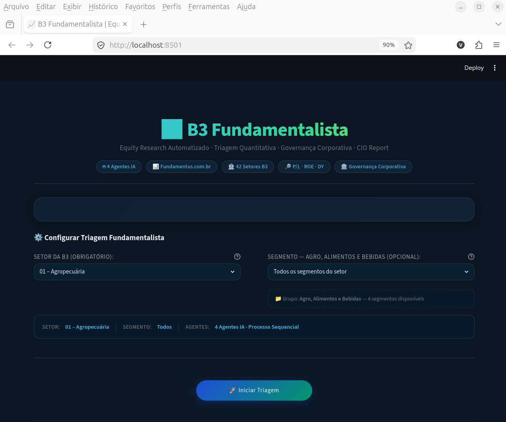

# B3 Fundamentalist Screener
### Engenharia Agêntica

---
Projeto desenvolvido para o curso I2A2 - Agentic AI: uma introdução.


Tela inicial

## Visão geral
Plataforma web que automatiza todo o fluxo de pesquisa fundamentalista de ações listadas na B3. A partir da seleção de **setor** e **subsetor**, quatro agentes de IA (CrewAI) realizam:

1. **Triagem quantitativa** – coleta dados reais de preço/lucro, ROE, Dividend Yield etc. via *fundamentus.com.br* e devolve os **5 melhores tickers**.
2. **Auditoria temporal** – verifica a consistência histórica do ROE e o crescimento de receita nos últimos 5 anos.
3. **Investigação de governança** – analisa free‑float, risco estatal e nível de governança (Novo Mercado, Nível 2, etc.).
4. **Relatório final (CIO)** – consolida as análises em um relatório executivo em Markdown com ranking, justificativas e recomendações de investimento.

Tudo isso ocorre com **uma única interação** na interface Streamlit, exibindo logs em tempo real e entregando um documento pronto para comitês de investimento.

---

## Tecnologias utilizadas

| Camada | Tecnologia | Motivo da escolha |
|--------|------------|-------------------|
| **Frontend** | **Streamlit** (Python) | Criação rápida de UI interativa, suporte a tema escuro e fácil integração com código Python. |
| **Estilização** | CSS customizado (glassmorphism, gradientes, tipografia *Inter* da Google Fonts) | Design premium, responsivo e com micro‑animações que dão “wow” ao usuário. |
| **Orquestração de agentes** | **CrewAI 0.11.2** (padrão *Task Factory*) | Permite definir agentes especializados e sequenciar tarefas sem necessidade de `inputs=` (compatível com a versão instalada). |
| **Modelo de linguagem** | **langchain‑openai 0.0.5** + **Google Cloud Vertex AI** (modelo *google/gemini-3-flash-preview*, endpoint OpenAPI com autenticação ADC, `max_tokens=12000`, `temperature=0.1`) | LLM de alta performance, consumo direto de créditos GCP/Vertex AI e integração estável com CrewAI. |
| **Aquisição de dados financeiros** | **fundamentus** (pacote Python) | API que raspa de forma estruturada o portal *fundamentus.com.br*, entregando tabelas de P/L, ROE, DY, crescimento de receita etc. |
| **Ferramentas customizadas** | `FundamentusScreenerTool`, `AuditorHistoricoTool`, `InvestigadorGovernancaTool` (subclasse de `BaseTool` do LangChain) | Garantem que o Triador, Auditor e Investigador trabalhem com dados reais e regras de negócio claras, eliminando falhas de buscas genéricas. |
| **Gerenciamento de ambiente** | **virtualenv** (`.venv`) + **pip** | Isolamento das dependências do projeto, facilitando replicação e implantação. |
| **Autenticação / Credenciais** | Google Cloud Application Default Credentials (ADC via `gcloud auth application-default login`) | Autenticação segura e nativa do GCP sem necessidade de expor chaves estáticas no código. |
| **Versionamento** | Estrutura de pastas `agents.py`, `tasks.py`, `tools.py`, `config.py`, `app.py` | Organização modular que permite extensão rápida (novos setores, novas métricas ou mudança de LLM). |

---

## Diferenciais do projeto

- **Dados estruturados e confiáveis** – todas as métricas vêm diretamente do *fundamentus*, sem depender de snippets de busca que costumam ser incompletos.
- **Pipeline totalmente automatizado** – o usuário clica em “Iniciar Triagem” e, em poucos segundos, recebe o ranking final.
- **Design avançado** – UI em dark‑mode com glassmorphism, tipografia premium e animações suaves, proporcionando uma experiência de alto nível visual.
- **Escalabilidade** – a arquitetura baseada em agentes e ferramentas facilita a inclusão de novos indicadores (ex.: valuation, métricas ESG) ou a migração para outros provedores de dados.
- **Controle de custos e completude** – `max_tokens=12000` e temperatura baixa garantem respostas aprofundadas e evitam truncamentos no raciocínio do Google Cloud Vertex AI.

---

## Executando a aplicação

### 1️⃣ Acessar o diretório do projeto
```bash
cd /home/vsvasconcelos/projetos/fundamentalista
```

### 2️⃣ Preparar e ativar o ambiente virtual (`.venv`)

Caso o ambiente virtual `.venv` já exista no diretório, basta ativá-lo:
```bash
source .venv/bin/activate
```

**Caso precise criar/recriar o ambiente virtual e instalar as dependências do zero:**

Opção A — Usando o script automatizado (`setup.sh`):
```bash
bash setup.sh
source .venv/bin/activate
```

Opção B — Manualmente via `venv` e `pip`:
```bash
python3 -m venv .venv            # cria o virtual-env
source .venv/bin/activate        # ativa o ambiente virtual
pip install --upgrade pip        # atualiza o pip
pip install -r requirements.txt  # instala as dependências
```

### 3️⃣ Configurar as credenciais (Google Cloud / Vertex AI)
Autentique-se no Google Cloud usando Application Default Credentials (ADC):
```bash
gcloud auth application-default login
```
*(Opcional)* Por padrão, o sistema utiliza o projeto `genai-vsv` e a localização `global`. Caso deseje sobrescrever via variáveis de ambiente:
```bash
export GCP_PROJECT_ID="genai-vsv"
export GCP_LOCATION="global"
```

### 4️⃣ Lançar a aplicação Streamlit
Com o ambiente `.venv` ativado, execute:
```bash
streamlit run app.py
```
A interface web será aberta automaticamente no navegador em `http://localhost:8501` (ou `http://127.0.0.1:8501`).

### 5️⃣ Usar a ferramenta
1. Selecione o **Setor da B3** desejado e, opcionalmente, filtre o **Segmento / Subsetor**.
2. Clique em **“🚀 Iniciar Triagem”**.
3. Acompanhe em tempo real os logs dos quatro agentes (`Triador` → `Auditor` → `Investigador` → `CIO`).
4. Visualize na interface os ativos identificados — trazendo o ticker e o nome da empresa na 1ª aparição, ex.: `SLCE3 (SLC Agrícola S.A.)` — e o **Relatório Executivo de Alocação** completo em Markdown logo abaixo (com opção de download em `.md`).
----

# Exemplo de relatório de saída
Os arquivos [relatorio_b3_bancos_bancos.md](relatorio_b3_bancos_bancos.md) e [relatorio_b3_agropecuária.md](relatorio_b3_agropecuária.md) ilustram exemplos da saída do sistema.
